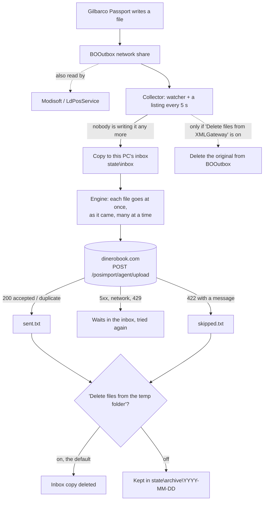

# DineroBook Processor and DineroBook Manager (Windows)

The store PC side of Gilbarco imports, replacing the Python site agent
(`agent/`) for new installs (owner, 2026-11-18). **DineroBook
Processor** is a Windows service (`DineroBookProcessor`) that sends
every file Passport writes to its BOOutbox folder to DineroBook.
**DineroBook Manager** is its window: connect, choose the folder,
install and watch the service.

It works the way the owner's LdPosService does (owner, 2026-11-19):
BOOutbox is always a **network share**, the service runs as
**NetworkService**, and **nobody at the store types an id, a name or a
password** — not for Windows, not for DineroBook. The PC is connected
with a one-time code made on dinerobook.com and scanned with the
store's barcode scanner.

The server does all the parsing and keeps every file raw, so the
Processor needs no update when parsing improves.



## Parts

| Folder | What |
|---|---|
| `Processor/` | The service (`DineroBookProcessor.exe`): a .NET Worker Service with `UseWindowsService()`, plus `--console` for testing. |
| `Manager/` | The window (`DineroBookManager.exe`, WinForms). |
| `Processor.Core/` | Everything both do, without the service or the window: the pipeline (`ProcessorEngine`), the business-day rules (`UploadScheduler`, `BusinessDateReader`), the ledger, the upload answers, the rate pacer, the agent key on disk (DPAPI), the connect call (`Connect/`), the network-path rules (`FolderCheck.cs`: `ServiceFolder`, `WindowsDriveMap`), and `ServerContract.cs`, the server values copied by hand. |
| `Processor.Tests/` | xUnit tests for `Processor.Core`. |
| `../DineroBookProcessor.sln` | Opens all four in Visual Studio. |

`tests/Modules/PosImport/test_processor_contract.py` (server side)
reads `ServerContract.cs` and fails when a limit, a path or an answer
field there no longer matches the server.

## What the Processor does

- **Sends every file** in the folder as it is: the journal (`PJR`),
  the movement reports (`FGM`, `ISM`, `MCM`, `MSM`, `TLM`, `TPM`) and
  anything else Passport writes there. No name or extension filter
  (owner, 2026-11-18); the server keeps each file raw and reads what it
  knows. Only hidden / system files (half-written temp files) and
  subfolders are left out.
- **Copies each file to this PC the moment it is complete, and sends
  from there** (`OutboxCollector`, owner, 2026-11-20). Modisoft's
  service, which stores run beside DineroBook while the two are
  compared, copies every file away and deletes it from BOOutbox within
  moments; the owner's LdPosService copies at once and runs beside it at
  50+ stores. So:
  - a **watcher** (`OutboxWatcher`, a FileSystemWatcher on the share)
    reports each new file the moment it appears, and the folder is still
    **listed every poll** (5 s, `pollSeconds`) in case the watcher
    missed one;
  - the watcher is checked on every pass and **made again, at most
    every 30 seconds**, when it failed, when the share came back after
    being unreachable (a watcher on a dropped share is dead even when it
    says nothing), or when a listing finds a new file the watcher still
    has not reported 2 seconds later (timed by this computer's clock,
    never the file's time: Passport's clock may be off). Store PCs are
    often on Wi-Fi, where the
    network drops; nothing is lost meanwhile, because the listing goes
    on every 5 seconds;
  - a file is copied once **nobody is writing it**: it is opened for
    reading while refusing other writers, so "Passport still has it
    open" fails and is tried again every 250 ms (for 2 minutes, then
    the next listing). Readers and deleters (Modisoft) are never in the
    way. Empty and hidden files wait;
  - the copy is written beside the inbox (`state\inbox\.incoming`) and
    moved in whole, then the name goes in that day's
    `state\collected\YYYY-MM-DD.txt` (`DailyLedger`, one file a day so
    none grows forever): a file is never copied twice, not after a
    restart and not when it stays in BOOutbox;
  - a file that leaves BOOutbox before it could be copied (another
    program took it first) is logged and counted as **Missed** on the
    Status tab.
- **BOOutbox is not changed unless the store says so.** With
  **Delete files from XMLGateway** off (the default), Passport's
  files are only read. On (Setup → 2, after a warning), each
  original is deleted once its copy is safe — the way Modisoft's
  service works — for a store where DineroBook is the only program
  reading the folder. A delete that fails (the share does not let this
  PC change files) is reported on the Status tab; the copy is sent
  anyway and the original stays.
- **Sends from the inbox at once, as files came** (owner, 2026-11-20).
  An inbox file is whole, so it goes the moment it lands (the collector
  wakes the sender): no business-day order, no waiting on another file,
  no settling. DineroBook puts each file in its tables as it comes and
  works out a day from the events' own start and end times. Many go at
  once; the only limit is the server's (the pacer below), so a burst of
  10 files reaches the server within about 3 seconds.
  Once DineroBook accepted it (or refused it for good), its inbox copy
  is dealt with as **Delete files from the temp folder** says (Setup →
  2, `deleteFromInbox`, `InboxFiles`): on (the default) it is
  deleted; off, it is moved to `state\archive\YYYY-MM-DD\` (the
  PC's local day) and kept there as a backup. Moved, not left in the
  inbox, so the inbox only holds files still to send. The sent ledger,
  not the copy, keeps a file from going twice.
- **No fixed number at once.** A store with 2–4 registers writes
  several files at the same moment, and they all go together; the
  server's rate limit (the pacer below) is the only limit (owner,
  2026-11-18). A slow or failing file never holds up any other; it waits
  in the inbox and is retried on its own (5 s, 15 s, 1 min, 5 min, …).
  (`patterns` and `maxConcurrentUploads` left in an older settings.json
  are ignored.)
- **Send to DineroBook can be off: collect only** (owner, 2026-11-20).
  The **Send** switch beside the DineroBook address (`sendToDineroBook`,
  on by default). Off, files are still copied into the temp folder
  (`state\inbox`) the moment they are complete, but nothing goes to the
  server and no connection is needed. The Status tab says how many files
  are collected, and **Open temp folder** shows them. The owner uses this
  to gather files from any Passport folder, BOInBox too (every file is
  copied, whatever its name). Turned on again, the files waiting in the
  temp folder are sent; the Manager asks first when there are any, so
  files that are not register files can be moved out before.
- **What "5 seconds" is.** `pollSeconds` in settings.json (default 5,
  allowed 2–300): how often the collector lists BOOutbox as the
  watcher's safety net, and how often the sender looks at the inbox when
  nothing woke it sooner. It is not a wait before sending: a file the
  watcher reports is copied at once and sent at once.
- **Business-day order is only for a folder read directly** (tests).
  `UploadScheduler` with `inOrder: true` sends older business days
  first and holds later days while an earlier one is on its way, for a
  server that booked day D as soon as a later day's file arrived. The
  service never runs that way any more.
- **Two loops side by side** (`Worker`): collecting and sending each
  run on their own, so a share that hangs never holds up files already
  copied, and a slow upload never holds up copying.
- **Never hangs on a dead share.** A call to a network share that went
  away does not fail, it waits — the owner's LdPosService logs showed
  12–16 minutes. So every call has a time limit: listing the folder
  20 s, reading a file's business day 20 s, reading a file to send it
  60 s, the Manager's **Check** 10 s. When one runs out the status says
  "Cannot open the Passport folder … did not answer within N seconds",
  nothing is lost, and the next poll tries again. A listing still out
  when the next one is due is waited on again, never started twice, so
  a dead share does not pile up stuck threads.
- **Paced under the server's limit** (`120/minute;6000/hour`): up to 8
  uploads at once, refilled at 5,000 an hour, never more than 100 in a
  minute. A first run in a folder with years of files takes a day or
  so, a day at a time; new sales show up once it has caught up.

Each answer of `POST /api/v2/posimport/agent/upload`:

| Answer | What happens |
|---|---|
| 200 | Done: in the ledger. Logged as `staged`, `duplicate` or `parse_error` (the server keeps the file and re-reads it after a parser fix). |
| 401 | The key was refused. Stops sending, the status says "connect again in DineroBook Manager", and it looks again every 5 minutes, at once when a new key is saved. |
| 402 / 403 | The store is closed to uploads (lapsed, frozen, disabled). Files wait; it looks again every 5 minutes. |
| 422 with a message | That file can never go (too large, no name): recorded in `skipped.txt`, never tried again. |
| 422 from the request check | The server no longer takes this version's upload format. Nothing is skipped; the status asks for an update. |
| 429 | Too many requests: everything pauses a minute. |
| 5xx, network, anything else | That file is tried again: 5 s, 15 s, 1 min, then every 5 min; the other files go on. Never dropped. After 3 failures of the same file it is an Error in the Event Log ("Stuck on …"). Two uploads colliding on the server come back as a 5xx too; the retry then finds the file staged (`duplicate`), which counts as sent. When every try fails (DineroBook or the network is down) it sends one file at a time on the same ladder until one goes through. |

Files over the server's 4 MB, or with names over 120 characters, are
skipped without sending (logged).

## On the store PC

Windows 10 or 11, 64-bit, on the back-office PC that opens Passport's
BOOutbox share, `\\10.5.48.2\XMLGateway\BOOutBox` at Gilbarco sites
(the Manager starts with that path filled in).

1. **Get the two programs.** GitHub → Actions → *DineroBook Processor*
   → the latest run → Artifacts → `DineroBookProcessor`. Unzip
   `DineroBookManager.exe` and `DineroBookProcessor.exe` into one folder
   (Downloads is fine: Install copies them to
   `C:\Program Files\DineroBook\Processor\`).
2. **SmartScreen.** v1 is not signed, so Windows says "Windows
   protected your PC" the first time: **More info → Run anyway**.
3. Open **DineroBookManager.exe** and choose **Restart as
   administrator** (setup changes the computer; the Status and Log
   tabs work without it).
4. **Setup → 1. Connect.** On dinerobook.com (any device, signed in as
   someone with the Day close edit permission — the admin or owner),
   open **Register import → Automatic uploads → Connect a computer**. It
   shows a code and its barcode, good for 10 minutes and one use. In the
   Manager choose **Connect…** and scan the barcode with the store's
   scanner (it types the code and presses Enter), or type the code.
   The Manager gets the store's upload key and keeps only that key. No
   username, no password. Connecting again revokes the computer's
   previous key.
5. **Setup → 2. Passport folder**: the share is filled in; **Check**,
   then **Save settings**. Browsing to a mapped drive (`Z:\BOOutBox`)
   saves its network path (`\\10.5.48.2\XMLGateway\BOOutBox`): the
   service never sees the person's drive letters. Leave the DineroBook
   address at `https://dinerobook.com`.
6. **Setup → 3. Windows service**: **Install / Update**. It installs as
   NetworkService, starts, and starts with Windows from then on
   (delayed start; Windows restarts it after 1 minute, again after 1,
   then every 5 if it stops).
7. **Status** shows the store, the last upload, today's count and what
   is waiting. **Test connection** checks the address and the key
   without sending a file.

### The account the service runs as

Always **NetworkService** (`NT AUTHORITY\NetworkService`), the account
the owner's LdPosService uses on store PCs. It reaches the BOOutbox
share as this computer, so there is no Windows account or password to
type, and nothing to redo when someone's password changes. An install
made by an older Manager (Local Service or a typed-in account) moves to
NetworkService on **Install / Update**; the Setup page says so. The
folder **Check** in Setup runs as you, not the service: the Status tab
says whether the service itself can read the share.

### Moving from the Python agent

Stop the old agent first (its Task Scheduler task or NSSM service), or
both upload every file. To skip re-sending what it already sent: after
Install, **Stop** the service, copy the agent's `uploaded.txt` to
`%ProgramData%\DineroBook\Processor\state\sent.txt` (same format), and
**Start** it. Without that every old file is sent once more and comes
back `duplicate`, which is harmless but takes hours on a big folder. The old key keeps
working until revoked: revoke it in DineroBook, **Register import →
Automatic uploads**.

## Files on the PC

All under `%ProgramData%\DineroBook\Processor\`, set up by Install:

| File | What | Who may write |
|---|---|---|
| `settings.json` | Passport folder, DineroBook address, which store and key (not the key itself) | Administrators |
| `agent-key.bin` | The store's upload key, DPAPI-encrypted for this PC; readable only by SYSTEM, Administrators and the service | Administrators |
| `state\inbox\` | Each Passport file, copied the moment it is complete; deleted once DineroBook has it. A copy waiting here is sent after a restart | the service |
| `state\collected\YYYY-MM-DD.txt` | Files copied from BOOutbox that day (name, time), one file a day. A name in any of them is never copied again. Old days may be deleted by hand: a file named there and still in BOOutbox would be copied again and come back "duplicate" | the service |
| `state\archive\YYYY-MM-DD\` | Sent files kept on this PC, only with **Delete files from the temp folder** off. Nothing clears it: delete old days by hand when the disk needs room | the service |
| `state\sent.txt` | Files DineroBook accepted (name, time, outcome). Safe to delete: the server keeps one copy per file name, so a resend comes back `duplicate` | the service |
| `state\skipped.txt` | Files refused for good, with why | the service |
| `state\status.json` | What the service is doing, for the Manager | the service |
| `state\logs\processor-YYYYMMDD.log` | One log a day, 14 days kept | the service |

The three settings in Setup → 2 (Send, and the two deletes) are on/off switches (`ToggleSwitch`, a
`CheckBox` drawn as a switch, owner 2026-11-20).

**Clear cache** (Setup → 3, `StateCache`). The three lists —
`sent.txt`, `skipped.txt` and `collected\*.txt` — only grow, and the
service reads them all into memory when it starts. A line is about 60
bytes (Passport names are 29 characters). A store writing 2,000 files a
day adds about 120 KB a day to each list: about 44 MB a year, and about
440 MB in ten years. With `sent.txt` and `collected` together that is
about 880 MB on disk, and the service would hold about 1.6 GB in memory.

The button stops the service, deletes those lists and starts it again.
Settings, the key, the logs, the inbox (files still to send) and the
archive stay. A file still in BOOutbox or the inbox goes once more, and
DineroBook answers `duplicate` for the ones it already has, so nothing
is counted twice. "Sent today" on the Status tab starts again from 0.

Errors also go to the Windows Event Log (Application, source
"DineroBook Processor"). No password and no sign-in token is ever kept,
and the key never appears in a log, the status or a message. The
Processor opens no network port.

**Connect again** issues a new key and revokes the old one. **Uninstall**
removes the service and its program file; it can also delete the saved
key (revoke it in DineroBook too). The data folder stays.

## Testing without installing

```powershell
DineroBookManager.exe --data-dir C:\temp\proc-test
DineroBookProcessor.exe --console --data-dir C:\temp\proc-test
```

`--data-dir` uses a test folder instead of ProgramData: connecting and
settings work without administrator rights, and the key file there
also admits the person who ran the Manager, so the `--console`
Processor started by the same person can read it. Point the address at
a test server on this computer (`http://localhost:<port>`; plain http
is accepted only for localhost). Never test with a real store's key.

## Build

`.github/workflows/dinerobook-processor.yml` builds with warnings as
errors, runs the tests and publishes both .exe files on every change
here. By hand on Windows with the .NET 8 SDK:

```powershell
dotnet test desktop/windows/Processor.Tests/Processor.Tests.csproj
dotnet publish desktop/windows/Processor/Processor.csproj -c Release -r win-x64 --self-contained true -p:PublishSingleFile=true -p:EnableCompressionInSingleFile=true -o publish
dotnet publish desktop/windows/Manager/Manager.csproj -c Release -r win-x64 --self-contained true -p:PublishSingleFile=true -p:EnableCompressionInSingleFile=true -o publish
```

## Rules for changes

- Passport's files are read only (list, open, read, close) unless the
  store turned on **Delete files from XMLGateway**; then only the
  collector deletes, and only after the copy is in the inbox and in
  the day's collected ledger. The engine never touches BOOutbox.
- Copy a file the moment it is complete (watcher + listing): another
  back office may take it away within seconds.
- Never drop a file; the only "never again" is a 422 with a message from
  the route itself.
- From the inbox, every file goes at once as it came — no business-day
  order and no waiting (owner, 2026-11-20). `BusinessDateReader`
  (whose event kinds the contract test compares with the server's)
  only orders a folder read directly.
- A watcher alone is never trusted: the folder is listed every poll,
  and the watcher is made again (at most every 30 s) when it failed,
  when the share came back, or when it missed a file.
- A server value used here goes in `ServerContract.cs` and its check in
  `test_processor_contract.py`.
- The key never reaches a log, the status, a message or a generated
  `ToString` (the classes holding secrets are not records for that
  reason). The Manager keeps nothing from connecting but the key.
- Nobody types an id, a name or a password: the service runs as
  NetworkService, and the Manager connects with a one-time code.
- Every call to the Passport folder has a time limit (`PassportFolder`).
- Setup that changes the machine (key, settings, service) needs
  administrator rights; viewing does not.

## Not yet

- A signed installer (SmartScreen warns until then), automatic updates,
  32-bit and ARM builds.
- A proxy setting: the service follows its own account's Windows proxy
  setting, which for NetworkService means a direct connection.
